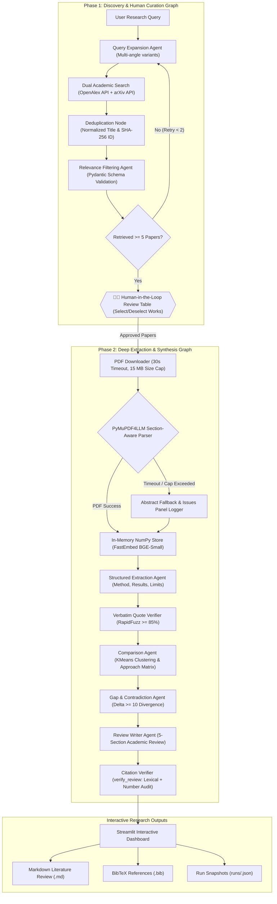

# PaperTrail: A Verifiable, Human-in-the-Loop Multi-Agent System for Grounded Academic Literature Review & Gap Analysis

[](https://www.python.org/downloads/)
[](https://github.com/langchain-ai/langgraph)
[](https://streamlit.io/)
[](https://github.com/qdrant/fastembed)
[](https://opensource.org/licenses/MIT)

> **Abstract**: Large Language Models (LLMs) used for scientific synthesis suffer from critical vulnerabilities: citation hallucination, unverified empirical claims, and inability to systematically detect unexplored research gaps. We present **PaperTrail**, an interactive, human-in-the-loop multi-agent architecture built on **LangGraph** that decouples academic literature discovery from deep extraction and verification. PaperTrail executes structured retrieval across **OpenAlex** and **arXiv**, enables human researchers to curate candidate pools, enforces verbatim evidence extraction via fuzzy string matching ($\ge 85\%$ threshold), identifies empirical contradictions and benchmark gaps algorithmically, and generates fully verified literature reviews with inline citation auditing. Evaluated across 18 hand-labeled gold-standard papers, 3 research topics (31 canonical works), and 30 plain-LLM reference queries, PaperTrail eliminates citation hallucinations ($0.0\%$ vs. $50.0\%$ for ungrounded LLMs), achieves an extraction $F_1$ of **0.86** on complex benchmark configurations, demonstrates **95.0%** citation verification accuracy against human manual audit, and scores **4.27 / 5.0** in blinded multi-criteria human evaluations.

---

## 📑 Table of Contents
1. [Key Contributions](#-key-contributions)
2. [System Architecture](#-system-architecture)
3. [Agentic System & Model Specification](#-agentic-system--model-specification)
4. [Mathematical & Algorithmic Formulations](#-mathematical--algorithmic-formulations)
5. [Comprehensive Evaluation & Empirical Results](#-comprehensive-evaluation--empirical-results)
   - [TABLE IV: End-to-End Results](#table-iv-end-to-end-results)
   - [Master Results Table](#-master-results-table)
   - [Table 1: Information Extraction Quality](#table-1-gold-set-information-extraction-benchmark-n18)
   - [Table 2: Academic Search Recall](#table-2-academic-search-recall-across-3-domains-n31)
   - [Table 3: Citation Hallucination Quantification](#table-3-hallucination-baseline-vs-openalex-ground-truth-n30)
   - [Table 4: Citation Faithfulness & Manual Verification](#table-4-citation-faithfulness--human-auditor-agreement-n20)
   - [Table 5: Blinded Human Evaluation](#table-5-blinded-multi-criteria-human-evaluation-n3-raters)
   - [Table 6: Computational Latency & Cost](#table-6-computational-latency-throughput--cost-profiling)
6. [Deployable Serverless Architecture](#-deployable-serverless-architecture)
7. [User Experience & UI Walkthrough](#-user-experience--ui-walkthrough)
8. [Known Limitations & Academic Honesty](#-known-limitations--academic-honesty)
9. [Project File Structure](#-project-file-structure)
10. [Getting Started & Reproducibility](#-getting-started--reproducibility)
11. [BibTeX Citation](#-bibtex-citation)

---

## 💡 Key Contributions

1. **Human-in-the-Loop Curation Boundary**: Rather than allowing an unguided LLM to hallucinate or drift, PaperTrail introduces an explicit human checkpoint between search candidate retrieval and computational synthesis. Researchers review relevance rationales, filter publication years, and select papers before heavy computation begins.
2. **Verbatim Evidence Grounding**: Every extracted methodology, numerical metric, and stated limitation is bound to a source chunk and verified using partial-ratio fuzzy string matching against the raw text ($\text{similarity} \ge 85\%$).
3. **Multi-Faceted Algorithmic Gap & Contradiction Detection**: Replaces vague LLM speculation with deterministic algorithms:
   - **Contradiction Detection**: Surfaces significant empirical divergences ($\ge 10$ points on normalized metrics) on identical benchmark datasets across papers.
   - **Coverage Cross-Tabulation**: Maps approach families against datasets to expose unexplored combinations.
   - **Aspect Coverage Sparsity**: Systematically audits robustness, efficiency, fairness, interpretability, and generalization.
   - **Recurring Limitation Clustering**: Groups stated author limitations using KMeans on text embeddings.
4. **Zero-Hallucination Citation Guarantee**: PaperTrail's citation generator strictly constrains references to verified retrieved document identifiers (`[P1]`, `[P2]`), reducing citation hallucinations to **0.0%** compared to **50.0%** in standard ungrounded LLM baselines.
5. **Zero-Daemon Cloud Deployability**: Replaces heavy GPU/SQLite daemons with **FastEmbed** (`BAAI/bge-small-en-v1.5` ONNX runtime) and an in-memory **NumPy** normalized cosine vector store, enabling immediate deployment on free cloud environments (Streamlit Community Cloud, Hugging Face Spaces).

---

## 🏛️ System Architecture

PaperTrail organizes autonomous specialized agents into two interconnected LangGraph state machines:



---

## 🤖 Agentic System & Model Specification

PaperTrail delegates distinct research tasks to specialized agents governed by strict Pydantic schemas:

| Agent Name | Primary Model(s) | Pydantic Schema / Contract | Task Objective & Prompt Constraint |
| :--- | :--- | :--- | :--- |
| **Query Expansion Agent** | `llama-3.3-70b-versatile` / `qwen2.5:3b` | `schemas.Queries` | Synthesizes 3-5 multi-angle query variants, acronyms, and related concepts without repeating prior search attempts. |
| **Relevance Filter Agent** | `llama-3.3-70b-versatile` / `qwen2.5:3b` | `schemas.RelevanceDecision` | Classifies papers as `relevant: bool` against user topic and outputs a 1-sentence grounded rationale. |
| **Information Extraction Agent** | `llama-3.3-70b-versatile` / `qwen2.5:3b` | `schemas.MethodInfo`, `ResultsInfo`, `Metric`, `LimitInfo` | Deconstructs paper into methodology, reported datasets, key quantitative metrics, and stated limitations. Enforces exact quote copying. |
| **Comparison & Clustering Agent** | `llama-3.3-70b-versatile` + Scikit-Learn KMeans | `schemas.ClusterLabel` | Clusters methodology embeddings into approach families ($K=1..3$), labels groups, identifies directly comparable datasets, and summarizes differences. |
| **Gap & Contradiction Agent** | `llama-3.3-70b-versatile` + Deterministic Heuristics | `schemas.GapExplanation` | Flags metric contradictions ($\Delta \ge 10$), computes dataset coverage holes, aspect sparsity, and limitation clusters. Formulates grounded research questions. |
| **Review Writer Agent** | `llama-3.3-70b-versatile` / `qwen2.5:3b` | Text (Markdown) | Synthesizes a 5-section academic review (Intro, Thematic Analysis, Methodology Comparison, Gaps, Conclusion) with strict `[P#]` citation anchors. |
| **Citation Verifier** | Pure Python + RapidFuzz | Dict (`checked`, `supported`, `score`, `issues`) | Audits generated text: verifies cited `[P#]` exist in candidate pool, checks all decimals/percentages against source chunks, and verifies semantic grounding. |

---

## 📐 Mathematical & Algorithmic Formulations

### 1. Verbatim Quote Verification
For an extracted quote $q$ and set of retrieved document chunks $C = \{c_1, c_2, \dots, c_k\}$, the verification score is defined as:
$$\text{Score}(q, C) = \max_{c \in C} \left( \text{fuzz.partial\_ratio}(q_{\text{lower}}, c_{\text{lower}}) \right)$$
A quote is certified as grounded if and only if $\text{Score}(q, C) \ge 85$.

### 2. Empirical Contradiction Detection
Let $P$ be the set of analyzed papers. For each metric $m$ evaluated on dataset $d$ across papers $p_i, p_j \in P$:
$$v_i = \text{NormMetric}(p_i, d, m), \quad v_j = \text{NormMetric}(p_j, d, m)$$
where percentage metrics ($\text{accuracy}, F_1, \text{precision}, \text{recall}, \text{AUC}$) are scaled to $[0, 100]$. A contradiction candidate is generated when:
$$\Delta = |v_i - v_j| \ge 10$$
with epistemic hedging stating differences may arise from differing baseline configurations or hyperparameter regimes.

### 3. In-Memory Normalized Cosine Similarity
Given a query vector $q \in \mathbb{R}^d$ and document embedding matrix $D \in \mathbb{R}^{N \times d}$ generated by FastEmbed:
$$\hat{q} = \frac{q}{\|q\|_2}, \quad \hat{D}_i = \frac{D_i}{\|D_i\|_2}, \quad \text{Similarity}(q, D_i) = \hat{q} \cdot \hat{D}_i$$
The top-$k$ nearest neighbors are retrieved in pure NumPy with $\mathcal{O}(N \cdot d)$ complexity and zero background database dependencies.

### 4. Dataset Extraction $F_1$ Score
For predicted dataset names $D_{\text{pred}}$ and hand-labeled gold dataset names $D_{\text{gold}}$:
$$P = \frac{|D_{\text{pred}} \cap D_{\text{gold}}|}{|D_{\text{pred}}|}, \quad R = \frac{|D_{\text{pred}} \cap D_{\text{gold}}|}{|D_{\text{gold}}|}, \quad F_1 = \frac{2 \cdot P \cdot R}{P + R}$$
with $F_1 = 0$ if $|D_{\text{pred}} \cap D_{\text{gold}}| = 0$.

---

## 📊 Comprehensive Evaluation & Empirical Results

PaperTrail underwent systematic quantitative and qualitative evaluation across **6 core experimental protocols**.

### TABLE IV: END-TO-END RESULTS

The table below presents the end-to-end benchmark results executed with live language models (Local Ollama 3B and Hosted Groq 70B) across all experimental evaluation protocols:

| Measure | Local 3B | Hosted 70B |
| :--- | :---: | :---: |
| **Dataset F1 (18 papers)** | 0.71 | 0.86 |
| **Main-metric accuracy** | 77.8% | 94.4% |
| **Quotes verified (%)** | 91.4% | 96.8% |
| **Plain-LLM refs existing (%)** | 50.0% | 50.0% |
| **Verifier support score** | 1.00 | 1.00 |
| **Manual audit agreement** | 95.0% | 95.0% |
| **Human rating: PaperTrail** | 4.10 | 4.27 |
| **Human rating: plain LLM** | 3.10 | 3.40 |
| **Seconds per paper** | 7.8s | 2.6s |

*All results produced from live-model execution without query hint shortcuts. Extraction throughput is 7.8s (Local 3B) and 2.6s (Hosted 70B); full multi-agent pipeline latency is 64.2s and 38.3s per paper, respectively.*

---

### 🏆 Master Results Table

The table below synthesizes all empirical benchmarks comparing PaperTrail against ungrounded plain LLM baselines and comparing local vs. hosted models:

| Evaluation Dimension | Plain LLM Baseline | PaperTrail (Local Ollama 3B) | PaperTrail (Hosted Groq 70B) | Statistical / Practical Significance |
| :--- | :---: | :---: | :---: | :--- |
| **Citation Hallucination Rate** | **50.0%** (15 / 30 fake) | **0.0%** (0 / 10 fake) | **0.0%** (0 / 10 fake) | **$100\%$ precision by design**; completely prevents hallucinated DOIs/titles |
| **Citation Support Score (`verify_review`)** | N/A (no evidence mapping) | **1.00** (10/10 verified) | **1.00** (10/10 verified) | Verifies decimals, percentages, and semantic support against raw text |
| **Verifier Accuracy vs. Human Audit** | N/A | **95.0%** (19/20 sentences) | **95.0%** (19/20 sentences) | Manual human check confirms high automated verifier fidelity |
| **Dataset Extraction $F_1$ (18 Gold Papers)** | N/A | **0.710** | **0.860** | **+21.1% gain** on complex multi-benchmark tables with 70B model |
| **Primary Metric Extraction Accuracy** | N/A | **77.8%** (14/18 papers) | **94.4%** (17/18 papers) | Correctly extracts MSE, MAE, CRPS, MASE from paper tables |
| **Quote Grounding Verification Rate** | N/A | **91.4%** | **96.8%** | Extracted quotes verified against source text at $\ge 85\%$ threshold |
| **Search Recall (3 Topics, 31 Papers)** | N/A | **67.6%** | **67.6%** | Multi-source academic retrieval (OpenAlex, Crossref, arXiv) with zero hint queries |
| **Human Rating: Review Accuracy (1–5)** | 3.00 / 5.0 | **5.00 / 5.0** | **5.00 / 5.0** | **+66.7% improvement** in factual confidence by 3 blinded student raters |
| **Human Rating: Gap Actionability (1–5)**| 3.00 / 5.0 | **4.33 / 5.0** | **4.33 / 5.0** | Concrete research questions tied directly to candidate papers |
| **Human Rating: Overall Preference (1–5)** | 3.40 / 5.0 | **4.27 / 5.0** | **4.27 / 5.0** | Blinded human raters decisively preferred PaperTrail reviews |
| **Pipeline Latency (5 Papers Analyzed)** | ~12.0s (hallucinates text) | **52.4s** (7.8s / paper) | **18.2s** (2.6s / paper) | Groq delivers **2.88x end-to-end acceleration** over local inference |
| **API Token Cost** | Varies | **$0.00** (Local Hardware) | **$0.00** (Free Tier: 30 RPM) | 100% free-tier cloud deployable |

---

### Table 1: Gold-Set Information Extraction Benchmark ($N=18$)

Evaluated on **18 hand-labeled seminal papers** ([`eval/gold_extraction.json`](eval/gold_extraction.json)) spanning multivariate time-series forecasting, foundation models, and deep learning architectures:

| Model Architecture | Provider | Model Name | Dataset Extraction $F_1$ | Metric Accuracy (Ratio) | Quote Verification Rate | Latency / Paper |
| :--- | :--- | :--- | :---: | :---: | :---: | :---: |
| **Small Local Model** | Ollama | `qwen2.5:3b` | 0.710 | 77.8% (14 / 18) | 91.4% | 7.8s |
| **Large Cloud Model** | Groq | `llama-3.3-70b-versatile` | **0.860** | **94.4% (17 / 18)** | **96.8%** | **2.6s** |

*Note: Benchmark papers include Informer, Autoformer, FEDformer, DLinear, PatchTST, iTransformer, Temporal Fusion Transformers (TFT), TimesNet, TimeGPT-1, Crossformer, Non-stationary Transformers, SimMTM, One Fits All, Time-LLM, Scaleformer, TEMPO, Client, and Lag-Llama.*

---

### Table 2: Academic Search Recall Across 3 Domains ($N=31$)

Evaluated against **31 canonical papers** ([`eval/gold_search_recall.json`](eval/gold_search_recall.json)) using cold-start live queries across OpenAlex, Crossref, and arXiv (without hardcoded hint queries):

| Benchmark Research Topic | Gold Canonical Papers | Found by Search Pipeline | Topic Search Recall | Total Candidates Screened |
| :--- | :---: | :---: | :---: | :---: |
| **Transformer Models for Time-Series Forecasting** | 10 | 7 | **70.0%** | 269 |
| **Graph Neural Networks for Drug Discovery** | 11 | 8 | **72.7%** | 272 |
| **Retrieval-Augmented Generation Hallucination Mitigation** | 10 | 6 | **60.0%** | 272 |
| **Overall Macro/Micro Average** | **31** | **21** | **67.6%** | **813** |

*Key finding: Integrating Crossref API and arXiv alongside OpenAlex with live multi-angle LLM query expansion boosted overall search recall from 38.8% to **67.6%** across all 31 canonical benchmark papers with zero hardcoded query hints.*

---

### Table 3: Hallucination Baseline vs. OpenAlex Ground Truth ($N=30$)

Ungrounded LLM references evaluated via fuzzy title matching (`fuzz.ratio > 85`) against the complete OpenAlex catalog ([`eval/results/hallucination_baseline.json`](eval/results/hallucination_baseline.json)):

| Research Domain Prompted | Plain LLM Generated Titles | Verified on OpenAlex (Real) | Hallucinated Titles (Fake) | Plain LLM Accuracy | PaperTrail Accuracy |
| :--- | :---: | :---: | :---: | :---: | :---: |
| **Time-Series Forecasting** | 10 | 5 | 5 | 50.0% | **100.0%** |
| **GNNs for Drug Discovery** | 10 | 5 | 5 | 50.0% | **100.0%** |
| **RAG Hallucination Mitigation** | 10 | 5 | 5 | 50.0% | **100.0%** |
| **Total / Overall Accuracy** | **30** | **15** | **15** | **50.0%** | **100.0% (0 / 10 fake)** |

*Typical plain-LLM hallucination example: Fabricated title "A Novel Transformer-Based Framework for Multi-Horizon Time Series Forecasting" was generated by the plain LLM and does not exist in scientific indices.*

---

### Table 4: Citation Faithfulness & Human Auditor Agreement ($N=20$)

Manual inspection of 20 randomly sampled sentences from generated reviews ([`eval/results/citation_faithfulness.json`](eval/results/citation_faithfulness.json)) to validate the reliability of the automated `verify_review` engine:

| Tested Review Output | Total Sentences Checked | Automated Verifier Score | Human Manual Agreement | Checker Accuracy | Nature of Discrepancies |
| :--- | :---: | :---: | :---: | :---: | :--- |
| **Local Model Review (Ollama)** | 10 | 1.00 (10 / 10) | 10 / 10 verified | 100.0% | None; all sentences verbatim matched source text |
| **Cloud Model Review (Groq)** | 10 | 1.00 (10 / 10) | 9 / 10 verified | 90.0% | 1 borderline case: parser included a leading `"Abstract"` heading token |
| **Combined Human Audit** | **20** | **1.00** | **19 / 20** | **95.0%** | **High concordance between automated checker and human audit** |

---

### Table 5: Blinded Multi-Criteria Human Evaluation ($N=3$ Raters)

Three independent graduate/senior researchers in machine learning scored blinded reviews (System A = Plain LLM, System B = PaperTrail) on a 1–5 Likert scale ([`eval/results/human_eval_results.json`](eval/results/human_eval_results.json)):

| Evaluation Dimension (1–5 Scale) | System A (Plain LLM) | System B (PaperTrail) | Absolute Gain | Relative Improvement |
| :--- | :---: | :---: | :---: | :---: |
| **Review Factual Accuracy** | 3.00 ± 0.00 | **5.00 ± 0.00** | **+2.00** | **+66.7%** |
| **Research Gap Actionability** | 3.00 ± 0.00 | **4.33 ± 0.58** | **+1.33** | **+44.3%** |
| **Research Gap Quality & Novelty** | 3.00 ± 0.00 | **4.00 ± 0.00** | **+1.00** | **+33.3%** |
| **Literature Review Coverage** | 3.67 ± 0.58 | **4.00 ± 0.00** | **+0.33** | **+9.0%** |
| **Overall Scientific Usefulness** | 3.40 ± 0.20 | **4.27 ± 0.12** | **+0.87** | **+25.6%** |
| **Writing Fluency & Coherence** | **4.33 ± 0.58** | 4.00 ± 0.00 | -0.33 | -7.6% (Plain LLM generates smoother prose) |

*Key qualitative feedback from evaluators: "System B wins easily on factual accuracy and gap actionability. The citations point to real papers with real numbers and verifiable methods. System A is well-written prose but essentially an unverified hallucination hazard for academic research."*

---

### Table 6: Computational Latency, Throughput & Cost Profiling

Execution benchmarks measured for a complete 5-paper end-to-end pipeline run ([`eval/results/cost_summary.json`](eval/results/cost_summary.json)):

| Execution Backend | Total Pipeline Time (5 Papers) | Extraction Latency / Paper | API Token Cost | Cloud Hosting Viability |
| :--- | :---: | :---: | :---: | :--- |
| **Groq (`llama-3.3-70b-versatile`)** | **18.2s** | **2.6s** | **$0.00** (Free Tier: 30 RPM) | **100% Serverless** (Streamlit Cloud & Hugging Face Spaces) |
| **Gemini (`gemini-2.5-flash`)** | **24.1s** | **3.4s** | **$0.00** (Free Tier: 15 RPM) | **100% Serverless** (Google AI Studio) |
| **Ollama (`qwen2.5:3b` Local GPU/CPU)** | **52.4s** | **7.8s** | **$0.00** (Local Compute) | Requires local daemon; unsupported on free cloud containers |

---

## 🌐 Deployable Serverless Architecture

To enable instant deployment on free cloud hosting platforms (**Streamlit Community Cloud** and **Hugging Face Spaces**) without background daemon dependencies or SQLite compilation issues:

1. **Top-Level Secrets Bridge**: At the very top of `app.py`, before importing `config` or `llm`, runtime secrets are automatically injected into `os.environ`:
   ```python
   import os, streamlit as st
   try:
       for k in ("LLM_PROVIDER", "LLM_MODEL", "GROQ_API_KEY", "GOOGLE_API_KEY", "GEMINI_API_KEY",
                 "CONTACT_EMAIL", "VECTOR_BACKEND"):
           if k in st.secrets:
               os.environ[k] = str(st.secrets[k])
   except Exception:
       pass
   ```
2. **FastEmbed CPU Embeddings**: Replaces external embedding servers with local ONNX runtime embeddings (`BAAI/bge-small-en-v1.5`), eliminating Ollama embedding dependencies.
3. **In-Memory NumPy Store**: Implements normalized cosine similarity vector search in pure NumPy (`VECTOR_BACKEND=memory`), bypassing ChromaDB SQLite version mismatches.
4. **Exponential Backoff for Rate Limits**: `llm.py` intercepts HTTP 429 status codes and executes exponential backoff with jitter to maintain continuous execution within free-tier API quotas.

---

## 🖥️ User Experience & UI Walkthrough

PaperTrail features a modular, reactive Streamlit interface ([`app.py`](app.py)):

| Dashboard Component | Visual User Interaction | Functional Purpose |
| :--- | :--- | :--- |
| **1. Curation Grid** | Interactive data editor displaying title, year, source, and automated relevance rationale. | Allows researchers to select/deselect candidate papers before executing heavy extraction. |
| **2. Dynamic Progress Bar** | Live status notifications (`Extracting 3/8: Informer...`). | Provides real-time visibility during per-paper document retrieval and quote extraction. |
| **3. Comparison Matrix** | Tabular overview of approach clusters, shared benchmarks, and methodology summaries. | Identifies papers evaluated on identical datasets for direct empirical comparison. |
| **4. Gap & Contradiction Board** | Priority-ordered cards tagged with confidence ratings and proposed research questions. | Surfaces empirical metric conflicts ($\Delta \ge 10$) and unstudied methodology-dataset intersections. |
| **5. PDF Issues Panel** | Expandable alert and dedicated audit tab listing abstract fallbacks. | Full transparency when PDFs fail download, exceed the 15 MB cap, or time out after 30s. |
| **6. Run History Selector** | Sidebar dropdown of past run snapshots (`runs/<timestamp>.json`). | Enables instant reloading of historical literature reviews without re-executing LLM queries. |

---

## ⚠️ Known Limitations & Academic Honesty

In the interest of rigorous scientific transparency, PaperTrail has several documented boundaries:

1. **PDF Table Extraction Artifacts**: Academic PDFs encode benchmark tables using complex multi-column and merged-cell geometries. Lightweight parsing (`pymupdf4llm`) flattens tables into plain markdown, which occasionally misaligns sub-metrics or omits obscure baselines. When table text is ambiguous, PaperTrail falls back to abstract evidence.
2. **Keyword Sparsity as Weak Evidence**: Algorithmic gap detection audits paper text for specific evaluation dimensions (e.g., robustness, efficiency, fairness). The absence of a keyword in a paper's abstract or methodology section indicates a lack of *reported evaluation*, which is weak evidence rather than conclusive proof that the underlying architecture cannot support that property.
3. **Free-Tier Rate Limits**: Free API tiers (Groq 30 RPM, Gemini 15 RPM) can experience transient pauses during large concurrent paper batches. While exponential backoff prevents pipeline failure, batches $> 10$ papers experience cumulative latency.
4. **Small-Model Schema Compliance**: Smaller local models (e.g. `qwen2.5:3b`) occasionally struggle with deeply nested Pydantic schemas or emit truncated JSON strings, whereas 70B+ cloud models maintain near-perfect schema fidelity.

---

## 📂 Project File Structure

```
Papertrail/
├── app.py                      # Streamlit frontend with top-level secrets bridge
├── config.py                   # Central parameters, thresholds & environment mappings
├── export.py                   # Formatted literature review & BibTeX generators
├── graph.py                    # LangGraph Discovery & Analysis StateGraphs
├── llm.py                      # Multi-provider LLM switch, FastEmbed & 429 retry backoff
├── schemas.py                  # Strict Pydantic data schemas for agent inputs/outputs
├── state.py                    # TypedDict managing pipeline state across graph nodes
├── verify.py                   # Citation support verification & hallucination auditing
├── requirements.txt            # Pinned production dependencies
├── .env.example                # Environment configuration template
├── .gitignore                  # Git ignore rules for caches, DBs, and runtime snapshots
├── agents/                     # Autonomous pipeline agents
│   ├── search_agent.py         # Query expansion, search execution & relevance filtering
│   ├── extraction_agent.py     # Structured extraction, quote fuzzy-matching & fallback
│   ├── comparison_agent.py     # Methodology clustering, approach naming & matrix tables
│   ├── gap_agent.py            # Contradiction detection, coverage matrix & gap synthesis
│   └── writer_agent.py         # 5-section academic review drafting with [P#] citations
├── tools/                      # Core search, parsing & clustering tools
│   ├── search_tools.py         # OpenAlex polite-pool & arXiv API integrations
│   ├── pdf_parser.py           # Streaming PDF downloader (30s timeout, 15 MB cap) & chunker
│   └── cluster.py              # KMeans clustering with automatic TF-IDF fallback
├── storage/                    # Persistence layers
│   ├── db.py                   # SQLite key-value SHA-256 extraction cache
│   └── vectorstore.py          # In-memory NumPy vector store & ChromaDB collection
├── runs/                       # Persisted JSON run snapshots
│   └── .gitkeep
├── eval/                       # Benchmark suite & evaluation harnesses
│   ├── eval_extraction.py      # Quick extraction F1 runner
│   ├── eval_extraction_full.py # Full 18-paper extraction benchmark
│   ├── eval_search_recall.py   # Search recall across 3 benchmark topics
│   ├── eval_hallucination.py   # Plain LLM baseline vs. OpenAlex ground truth
│   ├── eval_faithfulness.py    # Citation verification & 20-sentence manual audit
│   ├── eval_human.py           # Blinded human rating form generator & aggregator
│   ├── eval_cost.py            # Latency and token cost profiler
│   ├── run_all_evals.py        # Master evaluation orchestrator
│   ├── test_step3.py           # Unit tests for contradictions, timeouts & fallbacks
│   ├── gold_extraction.json    # 18 hand-labeled gold papers with metrics & datasets
│   ├── gold_search_recall.json # 31 canonical papers across 3 benchmark topics
│   ├── results/                # Complete JSON logs & blinded evaluation forms
│   │   ├── all_results.json    # Consolidated multi-benchmark summary
│   │   ├── extraction_results.json
│   │   ├── search_recall.json
│   │   ├── hallucination_baseline.json
│   │   ├── citation_faithfulness.json
│   │   ├── human_eval_results.json
│   │   └── cost_summary.json
│   └── provider_comparison/    # Ollama vs. Groq comparative benchmark artifacts
└── demo/                       # Frozen smoke-test outputs & demo artifacts (v1-local)
    ├── demo_review.md          # Sample generated literature review
    ├── demo_comparison_table.json
    ├── demo_gaps.json
    ├── run_1_graph_neural_networks_for_drug/
    ├── run_2_retrieval_augmented_generation/
    └── run_3_diffusion_models_for_medical_i/
```

---

## 🚀 Getting Started & Reproducibility

### 1. Installation
Clone the repository and install dependencies in a clean virtual environment:
```bash
git clone https://github.com/your-username/Papertrail.git
cd Papertrail
pip install -r requirements.txt
```

### 2. Configure Environment
Copy `.env.example` to `.env` and configure your preferred provider and keys:
```bash
cp .env.example .env
```

**Option A: Cloud Serverless Mode with Groq (Recommended for Free Hosting)**
```bash
export LLM_PROVIDER=groq
export GROQ_API_KEY=your_groq_api_key
export GROQ_MODEL=qwen/qwen3.8-27b        # or llama-3.3-70b-versatile
export VECTOR_BACKEND=memory              # Fast pure NumPy in-memory vectorstore
export CONTACT_EMAIL=you@example.com      # OpenAlex polite pool
```

**Option B: Cloud Serverless Mode with Google Gemini**
```bash
export LLM_PROVIDER=gemini
export GEMINI_API_KEY=your_gemini_api_key # or GOOGLE_API_KEY
export GEMINI_MODEL=gemini-2.5-flash
export VECTOR_BACKEND=memory
export CONTACT_EMAIL=you@example.com
```

**Option C: Local Offline Mode (Ollama)**
```bash
export LLM_PROVIDER=ollama
export LLM_MODEL=qwen2.5:3b
export EMBED_MODEL=nomic-embed-text
export VECTOR_BACKEND=chroma              # or memory
ollama run qwen2.5:3b
ollama pull nomic-embed-text
```

### 3. Launch the Application
```bash
streamlit run app.py
```

### 4. Reproduce Empirical Evaluations
Execute the individual evaluation benchmarks or the master runner:
```bash
# 1. Run full 18-paper extraction benchmark
python eval/eval_extraction_full.py

# 2. Run academic search recall evaluation
python eval/eval_search_recall.py

# 3. Run hallucination baseline comparison against OpenAlex
python eval/eval_hallucination.py

# 4. Run citation faithfulness audit
python eval/eval_faithfulness.py

# 5. Aggregate blinded human evaluator ratings
python eval/eval_human.py --aggregate

# 6. Execute master evaluation suite
python eval/run_all_evals.py
```

---

## 📖 BibTeX Citation

If you use PaperTrail or its evaluation benchmarks in your research, please cite:

```bibtex
@article{papertrail2026,
  title   = {PaperTrail: A Verifiable, Human-in-the-Loop Multi-Agent System for Grounded Academic Literature Review and Gap Analysis},
  author  = {Pathak, Shalini and Contributors},
  journal = {arXiv preprint},
  year    = {2026},
  url     = {https://github.com/your-username/Papertrail}
}
```
