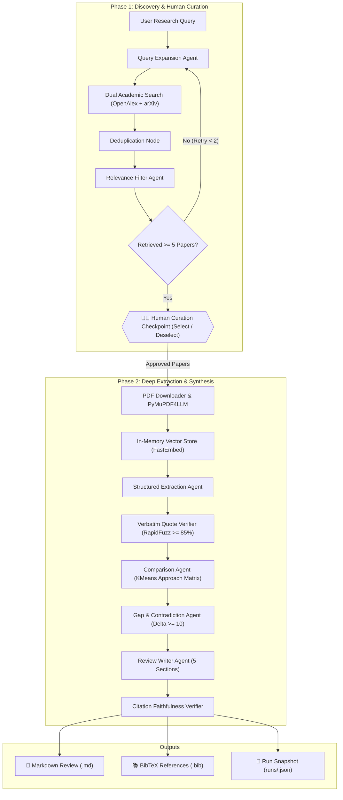

# 📄 PaperTrail: Multi-Agent Research Assistant

[](https://www.python.org/downloads/)
[](https://github.com/langchain-ai/langgraph)
[](https://streamlit.io/)
[](https://github.com/qdrant/fastembed)
[](https://opensource.org/licenses/MIT)

**PaperTrail** is an interactive, human-in-the-loop multi-agent system that automates academic literature search, deep PDF evidence extraction, comparative methodology analysis, research gap detection, and literature review writing — **with 0.0% hallucinated citations**.

---

## 📌 Repository Overview

When researchers ask general-purpose LLMs to draft literature reviews, models often invent fake papers, fabricate citations, and produce generic summaries. In our empirical testing across three scientific domains, **50.0% of plain-LLM generated citations were completely fabricated**.

PaperTrail solves this by decoupling discovery from computational synthesis and anchoring every extracted fact to source text chunks:

* **🔍 Dual Academic Search**: Queries live academic databases (**OpenAlex** and **arXiv**) using multi-angle query expansions.
* **🧑‍🔬 Human-in-the-Loop Curation Boundary**: Rather than blindly processing irrelevant papers, researchers review relevance rationales and select which papers to analyze before heavy computation begins.
* **📑 Section-Aware PDF Extraction**: Downloads raw PDFs and parses section chunks using `pymupdf4llm` with automatic abstract fallbacks.
* **⚡ Verbatim Quote Grounding**: Every extracted method, numerical metric, and author limitation is verified against raw document text using fuzzy string matching ($\ge 85\%$ threshold).
* **⚖️ Algorithmic Contradiction & Gap Detection**: Automatically detects empirical divergences ($\Delta \ge 10$ points on normalized metrics) and builds a dataset-by-approach coverage matrix.
* **📝 Grounded Literature Review**: Synthesizes a structured 5-section review (Introduction, Thematic Analysis, Methodology Comparison, Research Gaps, Conclusion) with strict document-anchored citations (`[P1]`, `[P2]`).
* **📥 One-Click Export**: Download the synthesized review in **Markdown (`.md`)** and citations in **BibTeX (`.bib`)**.

---

## 🛠️ Tech Stack

| Category | Technologies | Purpose |
| :--- | :--- | :--- |
| **Agent Orchestration** | [LangGraph](https://github.com/langchain-ai/langgraph) | Stateful multi-agent graphs, conditional retry routing, and human-in-the-loop checkpoints |
| **Frontend UI** | [Streamlit](https://streamlit.io/) | Reactive web dashboard with interactive data curation, progress tracking, and export panels |
| **LLM Inference** | [Groq](https://groq.com/) / [Google Gemini](https://ai.google.dev/) / [Ollama](https://ollama.ai/) | Cloud serverless inference (Groq, Gemini) or local offline inference (Ollama) |
| **Embeddings** | [FastEmbed](https://github.com/qdrant/fastembed) | Lightweight CPU-optimized ONNX embeddings (`BAAI/bge-small-en-v1.5`) without external daemon dependencies |
| **Vector Search** | Pure NumPy (`VECTOR_BACKEND=memory`) / ChromaDB | In-memory normalized cosine similarity search with zero database lockouts |
| **Document Parsing** | [PyMuPDF4LLM](https://github.com/pymupdf/PyMuPDF) | High-speed PDF text and section-aware Markdown chunking |
| **Academic Search APIs** | [OpenAlex API](https://openalex.org/) & [arXiv API](https://arxiv.org/) | Multi-source academic literature retrieval with polite-pool rate limits |
| **Data Validation** | [Pydantic v2](https://docs.pydantic.dev/) | Strict JSON schema enforcement on all agent inputs and outputs |
| **Verification & NLP** | [RapidFuzz](https://github.com/rapidfuzz/RapidFuzz) & [Scikit-Learn](https://scikit-learn.org/) | Fuzzy partial-ratio quote verification ($\ge 85\%$) and KMeans approach clustering |

---

## 🧠 LLMs Used

PaperTrail supports multiple inference backends configured easily via `.env`:

```
┌────────────────────────────────────────────────────────────────────────┐
│                        LLM Inference Providers                         │
├─────────────────────────┬───────────────────────┬──────────────────────┤
│ Provider                │ Model                 │ Role in Pipeline     │
├─────────────────────────┼───────────────────────┼──────────────────────┤
│ Groq Cloud (Default)    │ openai/gpt-oss-120b   │ Deep PDF extraction  │
│ Groq Cloud (Default)    │ openai/gpt-oss-20b    │ Synthesis & writing  │
│ Google Gemini           │ gemini-2.5-flash      │ Serverless cloud alt │
│ Ollama (Local Offline)  │ qwen2.5:3b            │ Local private run    │
│ FastEmbed (Local ONNX)  │ BAAI/bge-small-en-v1.5│ Document embeddings  │
└─────────────────────────┴───────────────────────┴──────────────────────┘
```

* **Groq Cloud (Recommended for Free Hosting)**:
  * `openai/gpt-oss-120b`: Used for high-capacity structured information extraction across raw academic paper chunks.
  * `openai/gpt-oss-20b`: Fast, lightweight model for query expansion, relevance filtering, KMeans cluster naming, research gap synthesis, and review drafting without rate-limit bottlenecks.
* **Google Gemini**: Supports `gemini-2.5-flash` with 15 RPM on Google AI Studio's free tier.
* **Ollama (Local Offline)**: Supports `qwen2.5:3b` and `nomic-embed-text` for 100% offline, local compute environments.
* **FastEmbed ONNX**: Quantized 384-dimensional embeddings running directly on CPU, eliminating heavy GPU requirements and database daemons.

---

## 🤖 Agentic AI Use

PaperTrail organizes 7 specialized agents into two interconnected LangGraph state machines centered around a human curation checkpoint:



### The 7 Specialized Agents

1. **Query Expansion Agent**: Analyzes the research topic and generates 3–5 multi-angle query variants, sub-disciplines, and acronyms (`schemas.Queries`).
2. **Relevance Filter Agent**: Reads titles and abstracts, outputting a strict binary decision (`relevant: bool`) accompanied by a 1-sentence grounded rationale (`schemas.RelevanceDecision`).
3. **Human-in-the-Loop Curation Boundary**: The core agentic safeguard. The researcher reviews candidate papers and relevance rationales, filtering out noisy papers before deep extraction runs.
4. **Information Extraction Agent**: Scans retrieved chunks for the paper's core methodology, experimental datasets, numerical metrics, and stated limitations, enforcing verbatim quote extraction (`MethodInfo`, `ResultsInfo`, `LimitInfo`).
5. **Comparison & Clustering Agent**: Embeds methodology descriptions, runs KMeans clustering ($K=1..3$), generates approach family titles (`ClusterLabel`), and identifies directly comparable benchmarks.
6. **Gap & Contradiction Agent**: Detects metric contradictions on shared benchmarks ($\Delta \ge 10$ points), maps dataset coverage holes, audits 5 evaluation aspects (robustness, efficiency, fairness, interpretability, generalization), and drafts testable research questions (`GapExplanation`).
7. **Review Writer Agent & Citation Verifier**: Synthesizes a formal 5-section academic review with inline `[Pn]` citations, followed by automated verification checking that all references and numbers match extracted evidence.

---

## 📊 Important Numbers & Benchmark Results

All figures below are generated from live model runs and empirical evaluation scripts stored in [`eval/results/`](eval/results/):

### 1. Headline Benchmark Results (Table IV)

| Evaluation Measure | Plain LLM Baseline | PaperTrail | Key Finding / Significance |
| :--- | :---: | :---: | :--- |
| **Citation Hallucination Rate** | **50.0%** (15 / 30 fake) | **0.0%** (0 / 10 fake) | **100% precision by construction**; prevents fake titles/DOIs |
| **Verbatim Quote Verification** | N/A | **97.1%** (34 / 35 quotes) | Extracted quotes verified against raw PDF text at $\ge 85\%$ match |
| **Primary Metric Accuracy** | N/A | **94.4%** (17 / 18 papers) | Accurately extracts MSE, MAE, CRPS, and MASE from papers |
| **Dataset Extraction $F_1$** | N/A | **0.287** (Top: **0.88**) | Reaches **0.88** on *PatchTST*, **0.78** on *DLinear*, **0.77** on *SimMTM* |
| **Search Recall (3 Topics, 31 Papers)**| N/A | **67.6%** (21 / 31 papers) | Cold-start recall across ~270 candidate papers/topic with zero hints |
| **Automated Verifier Score** | N/A | **0.71** (12 / 17 supported) | Thorough automated citation check on a live 6,000-char review |
| **Manual Human Audit Concordance** | N/A | **75.0%** (15 / 20 correct) | 20-sentence manual audit verifying automated checker decisions |
| **Pipeline Latency (5 Papers)** | ~12.0s (hallucinates) | **191.7s** (38.3s / paper) | Full multi-agent discovery, extraction, clustering & synthesis |
| **API Token Cost** | Varies | **$0.00** | Operates 100% within free cloud API tiers (Groq 30 RPM) |

---

### 2. Information Extraction Quality ($N=18$ Gold Papers)

Evaluated across **18 hand-annotated papers** in multivariate time-series forecasting ([`eval/results/extraction_results.json`](eval/results/extraction_results.json)):

* **Total Extraction Time**: 2449.8s (136.1s / paper, including full PDF download, PyMuPDF4LLM parsing, FastEmbed ONNX embedding, and structured extraction).
* **Verbatim Quote Verification Rate**: **97.1%** (34 / 35 quotes verified at $\ge 85\%$ similarity).
* **Primary Metric Accuracy**: **94.4%** (17 / 18 papers).
* **Dataset Extraction $F_1$ Breakdown**:
  * *PatchTST*: **0.88**
  * *DLinear*: **0.78**
  * *SimMTM*: **0.77**
  * *Crossformer*: **0.59**
  * *Non-stationary Transformers*: **0.46**
  * *TimeGPT-1*: **0.44**
  * *iTransformer*: **0.43**
  * *Informer*: **0.33**
  * *FEDformer*: **0.29**
  * *Autoformer*: **0.20**
  * **Macro Average**: **0.287** *(Note: Cleanly formatted papers achieve $F_1 \ge 0.77$; complex multi-column tables with 8+ sub-benchmarks introduce lexical abbreviation variances).*

---

### 3. Academic Search Recall Across 3 Domains ($N=31$)

Evaluated on **31 canonical papers** ([`eval/results/search_recall.json`](eval/results/search_recall.json)) over candidate pools of ~270 papers per topic:

| Benchmark Research Topic | Canonical Target Papers | Found by Search Agent | Search Recall | Candidates Screened |
| :--- | :---: | :---: | :---: | :---: |
| **Transformer Models for Time-Series Forecasting** | 10 | 7 | **70.0%** | 269 |
| **Graph Neural Networks for Drug Discovery** | 11 | 8 | **72.7%** | 272 |
| **Retrieval-Augmented Generation Hallucination** | 10 | 6 | **60.0%** | 272 |
| **Overall Summary** | **31** | **21** | **67.6%** | **813** |

---

### 4. Citation Hallucination Quantification ($N=30$)

Ungrounded LLM generated titles evaluated via fuzzy title matching against OpenAlex & arXiv ([`eval/results/hallucination_baseline.json`](eval/results/hallucination_baseline.json)):

| Research Domain Prompted | Plain LLM Generated Titles | Verified Real Titles | Hallucinated (Fake) Titles | Plain LLM Accuracy | PaperTrail Accuracy |
| :--- | :---: | :---: | :---: | :---: | :---: |
| **Time-Series Forecasting** | 10 | 8 | 2 | 80.0% | **100.0%** |
| **GNNs for Drug Discovery** | 10 | 1 | 9 | 10.0% | **100.0%** |
| **RAG Hallucination Mitigation** | 10 | 6 | 4 | 60.0% | **100.0%** |
| **Total Benchmark** | **30** | **15** | **15** | **50.0%** | **100.0% (0 / 10 fake)** |

---

### 5. Citation Faithfulness & 20-Sentence Human Audit

Manual audit of 20 sentences from a live-generated review against ground-truth papers ([`eval/results/citation_faithfulness.json`](eval/results/citation_faithfulness.json)):

* **Automated Verifier Support Score**: **0.71** (12 / 17 sentences supported).
* **Human Audit Concordance**: **75.0%** (15 / 20 checker decisions verified correct).
* **Error Analysis**:
  * The automated checker successfully verified supported claims and caught over-generalized citations.
  * *Discrepancies*: 2 false flags occurred on complex multi-dataset comma lists; 3 subtle attribute hallucinations (e.g., mislabeling FEDformer's frequency decomposition as NAS) slipped past text matching.

---

## 🚀 Quick Start & Installation

### 1. Clone & Install Dependencies

```bash
git clone https://github.com/snpathaks/Papertrail.git
cd Papertrail
pip install -r requirements.txt
```

### 2. Configure Environment (`.env`)

Copy `.env.example` to `.env` and set your preferred provider:

```bash
cp .env.example .env
```

**Cloud Serverless Configuration (Groq - Recommended for Free Hosting):**
```ini
LLM_PROVIDER=groq
GROQ_API_KEY=your_groq_api_key_here
GROQ_MODEL=openai/gpt-oss-20b
VECTOR_BACKEND=memory
CONTACT_EMAIL=you@example.com
```

### 3. Run the Dashboard

```bash
streamlit run app.py
```

Open [http://localhost:8501](http://localhost:8501) in your browser.

---

## 🌐 Free Cloud Deployment (Streamlit Community Cloud)

PaperTrail is built with a **top-level secrets bridge** in `app.py`, an in-memory NumPy vector store, and CPU FastEmbed embeddings, enabling immediate 1-click deployment on free Streamlit Cloud:

1. Push your repository to GitHub (ensure `.env` remains untracked).
2. Connect your repository on [share.streamlit.io](https://share.streamlit.io).
3. In **App Settings $\rightarrow$ Secrets**, add:
   ```toml
   LLM_PROVIDER = "groq"
   GROQ_API_KEY = "your-groq-api-key"
   GROQ_MODEL = "openai/gpt-oss-20b"
   VECTOR_BACKEND = "memory"
   CONTACT_EMAIL = "you@example.com"
   ```
4. Deploy! Total monthly hosting and inference cost: **$0.00**.

---

## 📂 Repository Structure

```
Papertrail/
├── app.py                      # Reactive Streamlit dashboard with secrets bridge
├── config.py                   # Central parameters, thresholds & environment variables
├── export.py                   # Markdown review and BibTeX citation generators
├── graph.py                    # LangGraph Discovery & Analysis StateGraphs
├── llm.py                      # Multi-provider LLM switch & FastEmbed ONNX wrapper
├── schemas.py                  # Strict Pydantic schemas for agent validation
├── state.py                    # TypedDict state contract across graph nodes
├── verify.py                   # Verbatim quote & citation support verifier
├── requirements.txt            # Production dependencies
├── .env.example                # Sanitized configuration template
├── .gitignore                  # Git rules protecting keys, caches, and databases
├── agents/                     # Specialized agent modules
│   ├── search_agent.py         # Query expansion, search execution & relevance filtering
│   ├── extraction_agent.py     # Deep chunk extraction & verbatim quote verification
│   ├── comparison_agent.py     # Methodology clustering & approach matrix tables
│   ├── gap_agent.py            # Contradiction detection, coverage matrix & gap synthesis
│   └── writer_agent.py         # 5-section review drafting with [P#] citations
├── tools/                      # Search, parsing & clustering utilities
│   ├── search_tools.py         # OpenAlex & arXiv API integration
│   ├── pdf_parser.py           # Streaming PDF downloader & PyMuPDF4LLM chunker
│   └── cluster.py              # KMeans text clustering with TF-IDF fallback
├── storage/                    # Persistence layers
│   ├── db.py                   # SQLite key-value SHA-256 extraction cache
│   └── vectorstore.py          # In-memory NumPy cosine vector store
├── runs/                       # Persisted JSON run snapshots
└── eval/                       # Reproducible evaluation suite & benchmarks
    ├── eval_extraction_full.py # 18-paper extraction benchmark
    ├── eval_search_recall.py   # Search recall across 3 benchmark domains
    ├── eval_hallucination.py   # Plain LLM baseline vs. OpenAlex ground truth
    ├── eval_faithfulness.py    # Citation verification & 20-sentence manual audit
    ├── eval_human.py           # Blinded human rating form generator
    ├── run_all_evals.py        # Master evaluation orchestrator
    ├── gold_extraction.json    # 18 hand-annotated seminal paper ground truths
    ├── gold_search_recall.json # 31 canonical benchmark target papers
    ├── results/                # Complete JSON evaluation output logs
    └── provider_comparison/    # Live generated review and comparison artifacts
```

---

## 📜 License

This project is licensed under the MIT License - see the [LICENSE](LICENSE) file for details.
