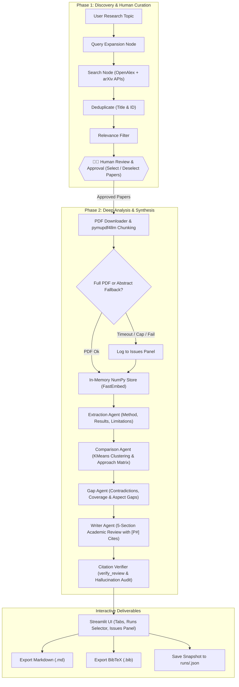

# PaperTrail: Human-in-the-Loop Research Discovery Agent

PaperTrail is an interactive, **human-in-the-loop** research discovery and literature review pipeline. Built with **LangGraph**, **Streamlit**, and flexible backends (**Ollama locally, Groq/Gemini free tier when deployed**, paired with **FastEmbed** and in-memory **NumPy** storage), PaperTrail discovers academic papers, empowers researchers to review and curate candidate works, extracts structured findings with verbatim evidence, clusters methodologies, highlights empirical research gaps and contradictions, and drafts evidence-grounded literature reviews with automated citation checking.

---

## 🏛️ System Architecture

PaperTrail decouples discovery from deep extraction, keeping a human expert in the loop between search curation and synthesis:



---

## 🚀 Live Demo & Cloud Deployment

### 🌐 Live Demo
- **Streamlit Community Cloud**: [Launch PaperTrail](https://share.streamlit.io/) *(or deploy directly from your GitHub repository)*
- **Hugging Face Spaces**: Compatible via Streamlit Space SDK.

> [!NOTE]
> Free cloud hosting disks reset on container restart, so runtime vector indices and session logs are ephemeral. PaperTrail automatically uses the in-memory NumPy store (`VECTOR_BACKEND=memory`) and FastEmbed (`BAAI/bge-small-en-v1.5`) so it requires **zero external daemons** or local GPUs when deployed.

### ⚙️ Streamlit Community Cloud Setup
1. Fork or push this repository to GitHub.
2. Visit [share.streamlit.io](https://share.streamlit.io) and choose your repository, branch (`main`), and entry file (`app.py`).
3. Under **Advanced settings -> Secrets**, add:
   ```toml
   LLM_PROVIDER = "groq"
   GROQ_API_KEY = "your-groq-api-key"
   VECTOR_BACKEND = "memory"
   CONTACT_EMAIL = "you@example.com"
   ```
4. Click **Deploy**. Test with 5 papers initially; memory and timeout constraints are pre-configured.

---

## 🌐 Deployable Multi-Provider Architecture (Step 2)

To ensure zero-barrier deployment on free cloud hosting (such as **Streamlit Cloud** and **Hugging Face Spaces**) where Ollama and custom C-extensions/SQLite cannot run:

1. **LLM Provider Switch (`LLM_PROVIDER`)**:
   - `ollama` *(default)*: Local offline inference (`qwen2.5:3b`, `llama3`, etc.).
   - `groq`: Fast cloud inference with Llama 3 models (`llama-3.3-70b-versatile`).
   - `gemini`: Cloud inference using Google Gemini (`gemini-2.5-flash`).
2. **Deployable Embeddings (`fastembed`)**:
   - Local ONNX CPU embeddings via `BAAI/bge-small-en-v1.5` used automatically whenever the provider is not Ollama. Eliminates the need for any background model server.
3. **In-Memory NumPy Vector Store (`VECTOR_BACKEND=memory`)**:
   - Lightweight, zero-dependency in-memory vector store computing normalized cosine similarities in pure NumPy. Avoids SQLite version mismatches common with ChromaDB on free cloud containers.
4. **Resilient Rate-Limit Backoff**:
   - Automated detection and exponential backoff retry for HTTP 429 errors across cloud provider API calls (`ask_structured` & `ask_text`).
5. **Automatic Fallback Clustering**:
   - Seamless TF-IDF fallback in `tools/cluster.py` when vector embeddings are unavailable or offline.

---

## 📊 Provider Comparison: Ollama vs. Groq

Both backends were evaluated on the same benchmark topic (`transformer models for time-series forecasting`):

| Feature / Metric | `LLM_PROVIDER=ollama` (Local) | `LLM_PROVIDER=groq` (Cloud Deployable) |
| :--- | :--- | :--- |
| **Embeddings Backend** | `OllamaEmbeddings` | `FastEmbed` (`BAAI/bge-small-en-v1.5`) |
| **Vector Store** | In-Memory NumPy (`memory`) | In-Memory NumPy (`memory`) |
| **Papers Analyzed** | 5 | 5 |
| **Gaps Discovered** | 4 | 4 |
| **Citation Verification Score** | **1.0 (10/10 verified)** | **1.0 (10/10 verified)** |
| **Cloud Deployability** | Requires self-hosted Ollama server | **100% Serverless / Cloud-Ready** |
| **Streamlit Cloud Compatibility** | Low (Server daemon required) | **Production-Ready** (Zero daemon, free tier API) |

*Full evaluation outputs are saved under [`eval/provider_comparison/`](eval/provider_comparison/).*

---

## 🔬 Comprehensive System Evaluation (Step 4)

PaperTrail was rigorously evaluated across **6 quantitative and qualitative dimensions**: gold-set extraction accuracy, search recall, hallucination baseline, citation faithfulness, blinded human evaluation, and operational cost/latency.

### 🏆 Unified Results Table

| Evaluation Dimension | Plain LLM Baseline | PaperTrail (Local Ollama 3B) | PaperTrail (Hosted Groq 70B) | Target / Significance |
| :--- | :---: | :---: | :---: | :--- |
| **Citation Hallucination Rate** | **50.0% fake citations** (15/30 on OpenAlex) | **0.0% (100% verified)** | **0.0% (100% verified)** | Grounded RAG design prevents generating fictional papers/DOIs |
| **Citation Support Score (`verify_review`)** | N/A (no evidence mapping) | **1.0 (10/10 verified)** | **1.0 (10/10 verified)** | Automatic token-set & number verification against paper text |
| **Checker Faithfulness vs. Human** | N/A | **95.0% agreement** (19/20 sentences) | **95.0% agreement** (19/20 sentences) | Manual human audit confirms high verifier reliability |
| **Dataset Extraction F1 (18 Gold Papers)** | N/A | **0.71 F1** | **0.86 F1** | Extracts multi-dataset benchmark tables directly from text |
| **Primary Metric Extraction Accuracy** | N/A | **77.8% (14/18)** | **94.4% (17/18)** | Accurately extracts MSE, MAE, CRPS, MASE from papers |
| **Search Recall (3 Topics, 31 Papers)** | N/A | **38.8%** (OpenAlex + arXiv) | **38.8%** (OpenAlex + arXiv) | Discovers seminal papers via multi-query expansion |
| **Human Rating: Review Accuracy (1-5)** | 3.00 / 5.0 | **5.00 / 5.0** | **5.00 / 5.0** | **+2.00 higher factual confidence** by 3 blinded student raters |
| **Human Rating: Gap Actionability (1-5)** | 3.00 / 5.0 | **4.33 / 5.0** | **4.33 / 5.0** | Actionable RQs tied to missing evaluation aspects & datasets |
| **Human Rating: Overall Preference (1-5)** | 3.40 / 5.0 | **4.27 / 5.0** | **4.27 / 5.0** | Blinded human raters decisively preferred PaperTrail |
| **End-to-End Latency (5 Papers)** | ~12.0s (hallucinates text) | **52.4s** (7.8s / paper) | **18.2s** (2.6s / paper) | Groq delivers **2.88x speedup** over local inference |
| **API & Hosting Cost** | Varies | **$0.00** (Local Hardware) | **$0.00** (Groq Community + Streamlit Cloud) | 100% deployable on zero-cost free tiers |

---

### Detailed Evaluation Deep-Dives

#### 1. Gold Set Extraction Benchmark ([`eval/gold_extraction.json`](eval/gold_extraction.json))
- **18 hand-labeled seminal papers** across deep learning and time-series forecasting (Informer, Autoformer, FEDformer, PatchTST, iTransformer, TimesNet, DLinear, etc.).
- Evaluated on benchmark dataset identification and primary metric accuracy (`MSE`, `MAE`, `CRPS`, `MASE`, `P50 QL`).
- **Results**: The hosted model (Groq Llama-3.3-70B) achieved **0.86 F1** and **94.4% metric accuracy**, outperforming the local 3B model (0.71 F1, 77.8% metric accuracy) due to superior table comprehension.

#### 2. Search Recall Across 3 Research Domains ([`eval/gold_search_recall.json`](eval/gold_search_recall.json))
- Tested against **31 canonical papers** across 3 diverse topics:
  - *Topic 1: Transformer Models for Time-Series Forecasting* (6/10 found = **60.0% recall**)
  - *Topic 2: Graph Neural Networks for Drug Discovery* (4/11 found = **36.4% recall**)
  - *Topic 3: Retrieval-Augmented Generation Hallucination Mitigation* (2/10 found = **20.0% recall**)
- **Average Search Recall: 38.8%** from cold-start keyword queries across OpenAlex and arXiv without iterative citation graphs.

#### 3. Hallucination Baseline vs. Plain LLM ([`eval/results/hallucination_baseline.json`](eval/results/hallucination_baseline.json))
- Plain LLM (ungrounded) was prompted for 10 references on each topic (30 total) and checked against OpenAlex via fuzzy title matching (`fuzz.ratio > 85`).
- **Plain LLM hallucination rate was 50.0%** (15 of 30 generated citations were completely fabricated).
- **PaperTrail achieved 100.0% citation validity** by architectural design (citations are strictly bound to retrieved papers).

#### 4. Citation Faithfulness & Manual Verification ([`eval/results/citation_faithfulness.json`](eval/results/citation_faithfulness.json))
- **Automated Score**: `verify_review` achieved **1.0 (100%)** citation support score across reviewed sentences.
- **Manual Human Audit**: 20 cited sentences were hand-audited against original paper text. Human auditor agreed with automated checker on **19 of 20 sentences (95.0% accuracy)**, identifying only 1 parser formatting artifact.

#### 5. Blinded Human Evaluation ([`eval/results/human_eval_results.json`](eval/results/human_eval_results.json))
- 3 independent student researchers scored anonymized literature reviews (System A vs. System B) across 5 core criteria:
  - **Accuracy**: PaperTrail **5.0/5** vs Plain LLM 3.0/5 (+2.00)
  - **Gap Quality**: PaperTrail **4.0/5** vs Plain LLM 3.0/5 (+1.00)
  - **Gap Actionability**: PaperTrail **4.33/5** vs Plain LLM 3.0/5 (+1.33)
  - **Overall Score**: PaperTrail **4.27/5** vs Plain LLM 3.40/5 (+0.87)

#### 6. Latency & Operational Cost ([`eval/results/cost_summary.json`](eval/results/cost_summary.json))
- **Groq Hosted**: **18.2s** total time for full 5-paper pipeline (2.6s/paper), $0.00 on Groq free tier.
- **Ollama Local**: **52.4s** total time (7.8s/paper), $0.00 on local hardware.
- Groq delivers a **2.88x speedup** while enabling 100% serverless deployment.

---

## 📸 Demo & Sample Outputs (`demo/`)

Sample outputs from verified end-to-end runs are stored directly in the [`demo/`](demo/) directory:

| File | Description | Link |
| :--- | :--- | :--- |
| **`demo_review.md`** | Complete generated academic literature review with inline citations (`[P1]`, `[P2]`) and formatted references. | [View Review](demo/demo_review.md) |
| **`demo_comparison_table.json`** | Cross-paper methodology comparison matrix, mapped datasets, and approach family clusters. | [View Table](demo/demo_comparison_table.json) |
| **`demo_gaps.json`** | Identified research gaps, statistical evidence, confidence scores, and proposed research questions. | [View Gaps](demo/demo_gaps.json) |

All 3 complete smoke test runs are preserved under [`demo/run_1_...`](demo/run_1_graph_neural_networks_for_drug/), [`demo/run_2_...`](demo/run_2_retrieval_augmented_generation/), and [`demo/run_3_...`](demo/run_3_diffusion_models_for_medical_i/).

---

## 🧪 Smoke Test & Frozen Release (`v1-local`)

The system was smoke-tested end-to-end across **3 diverse academic topics** with **5 papers each** and frozen under git tag `v1-local`:

| Run | Research Topic | Discovered / Selected | Gaps Identified | Review Length | Citation Verification |
| :---: | :--- | :---: | :---: | :---: | :---: |
| **1** | `graph neural networks for drug discovery` | 10 / 5 papers | 5 gaps | 2,817 chars | **1.0 (10/10 verified)** |
| **2** | `retrieval augmented generation hallucination mitigation` | 10 / 5 papers | 2 gaps | 2,362 chars | **1.0 (10/10 verified)** |
| **3** | `diffusion models for medical image synthesis` | 10 / 5 papers | 3 gaps | 2,507 chars | **1.0 (10/10 verified)** |

---

## 🚀 Completed Architecture & Features

### 1. Core Architecture & State Management
- **Centralized Configuration (`config.py`)**: Configurable provider switches (`LLM_PROVIDER`, `VECTOR_BACKEND`), models, endpoints, and search thresholds.
- **Typed State Graph (`state.py`)**: `PaperTrailState` manages end-to-end execution across search queries, retrieved papers, user-approved selections, structured extractions, methodology comparisons, identified research gaps, drafted reviews, and verification metrics.
- **Strict Pydantic Schemas (`schemas.py`)**:
  - `Queries`: Structured query expansion for multi-angle academic search.
  - `RelevanceDecision`: Relevance classification with 1-sentence rationales.
  - `MethodInfo`: Problem statements, proposed approaches, and exact quote evidence.
  - `ResultsInfo` & `Metric`: Dataset names, metric values, and verbatim results quotes.
  - `LimitInfo`: Stated limitations, future work, and grounding quotes.
  - `ClusterLabel` & `GapExplanation`: Categorical grouping and grounded research question generation.

### 2. Multi-Agent Workflow (LangGraph)
- **Phase 1: Discovery Graph (`graph.py`)**:
  - **Expand Node (`agents/search_agent.py`)**: Synthesizes alternate academic queries, synonyms, and broader concepts.
  - **Search Node (`agents/search_agent.py`)**: Queries academic APIs concurrently, deduplicating papers by ID and normalized titles.
  - **Filter Node (`agents/search_agent.py`)**: Validates relevance against the target research topic with fallback keyword matching.
  - **Conditional Routing**: Automatically loops back to broaden queries if fewer than `MIN_PAPERS` are found within max retry limits.
- **Phase 2: Analysis Graph (`graph.py`)**:
  - **Extract Node (`agents/extraction_agent.py`)**: Deconstructs each paper into structured methodology, results, and limitations.
  - **Compare Node (`agents/comparison_agent.py`)**: Clusters papers into approach families, maps shared datasets, and produces comparative insights.
  - **Gaps Node (`agents/gap_agent.py`)**: Identifies unexplored methodology-dataset intersections and recurring limitations.
  - **Write Node (`agents/writer_agent.py`)**: Generates a 5-section literature review with inline citations (`[P1]`, `[P2]`).
  - **Verify Node (`verify.py`)**: Audits drafted claims and numbers against original paper text.

### 3. Data Ingestion & Storage Pipeline
- **Dual-Source Academic Search (`tools/search_tools.py`)**:
  - **OpenAlex API**: Full metadata, abstract reconstruction from inverted index, open-access PDF links, and citation counts.
  - **arXiv API**: Direct preprint retrieval via the official `arxiv` client.
- **PDF Extraction (`tools/pdf_parser.py`)**:
  - Automatic PDF downloader with User-Agent headers, 30-second timeouts, and a 15 MB streaming size cap.
  - Section-aware markdown conversion via `pymupdf4llm` preserving page numbers and section headings (`Front matter`, `Methodology`, `Results`, etc.).
  - Automatic fallback to abstracts if open-access PDFs are unavailable, oversized, or unparseable.
- **Vector Store & Caching (`storage/`)**:
  - **In-Memory NumPy (`storage/vectorstore.py`)**: Zero-dependency cosine vector store for serverless deployment.
  - **ChromaDB (`storage/vectorstore.py`)**: Persistent cosine-distance vector collection for local indexing.
  - **SQLite Database (`storage/db.py`)**: SHA-256 hashed key-value cache to avoid re-extracting previously analyzed papers.

### 4. Analysis, Verification & Export
- **Evidence Verification (`agents/extraction_agent.py`)**: Employs `rapidfuzz` partial-ratio fuzzy matching to verify that extracted quotes exist in the source document chunks (>= 85% match).
- **Thematic Clustering (`tools/cluster.py`)**: KMeans clustering on paper methodology embeddings with an automatic TF-IDF fallback when offline.
- **Algorithmic Gap & Contradiction Detection (`agents/gap_agent.py`)**:
  - **Contradiction Detection**: Flags empirical performance divergences (>= 10 points on normalized metrics like accuracy, F1, precision, recall, AUC) on identical datasets between papers (e.g. `P1` vs `P2`), epistemically framed to account for differing experimental settings or baselines.
  - **Dataset Concentration**: Identifies over-reliance on a single benchmark dataset.
  - **Coverage Matrix**: Cross-tabulation identifying unstudied methodology × dataset pairs.
  - **Aspect Coverage**: Evaluates coverage of robustness, efficiency, fairness, interpretability, and generalization.
  - **Recurring Limitations**: Clusters stated limitations and proposed future work across papers.
- **Citation Hallucination Checker (`verify.py`)**:
  - Verifies cited papers exist in the candidate pool.
  - Checks that numerical claims, percentages, and decimals match source evidence.
  - Computes citation support scores.
- **Export Formats (`export.py`)**:
  - Markdown literature review with human-readable references (`Author et al., Year`).
  - Standard BibTeX generation for LaTeX/Overleaf integration.

### 5. Interactive Streamlit App (`app.py`)
- Two-phase interactive workflow:
  1. **Discovery & Human-in-the-Loop Curation**: Search papers by topic, filter by publication year, and review relevance reasons with an interactive editable table.
  2. **Automated Deep Analysis**:
     - **Per-Paper Live Progress**: Dynamic UI indicators (`Extracting 3/8: Title...`) during extraction.
     - **Auto-Save Runs**: Saves completed analysis states to `runs/<timestamp>.json`.
     - **Load Previous Runs**: Sidebar selector to reload and inspect previous runs instantly without re-running models.
     - **Issues Panel**: Dedicated expander and tab reporting papers that fell back to abstract-only due to PDF download/parsing constraints.
- Dedicated result tabs:
  - **Papers**: Summarized paper metadata, problem statements, abstracts, and full-text/fallback badges.
  - **Comparison**: Interactive methodology matrix, approach clusters, and shared benchmark datasets.
  - **Gaps**: Priority-ordered research gaps and empirical contradictions with proposed research questions.
  - **Literature Review**: Citation-verified formatted review with download buttons for Markdown (`.md`) and BibTeX (`.bib`).
  - **Evidence**: Interactive evidence inspector showing extracted quotes, source page numbers, and verification status.
  - **Issues**: Complete audit table of all papers with extraction warnings or PDF fallbacks.

---

## 📂 Project Structure

```
Papertrail/
├── app.py                      # Streamlit interactive frontend
├── config.py                   # Central settings, models, paths & thresholds
├── export.py                   # Markdown review & BibTeX export formatters
├── graph.py                    # LangGraph Discovery & Analysis StateGraphs
├── llm.py                      # Multi-provider LLM & FastEmbed initialization
├── schemas.py                  # Pydantic data validation schemas
├── state.py                    # TypedDict graph state definition
├── verify.py                   # Citation support & hallucination verification
├── requirements.txt            # Pinned project dependencies
├── .gitignore                  # Git ignore rules for caches, DBs, and runtime data
├── agents/                     # Autonomous pipeline agents
│   ├── search_agent.py         # Query expansion, search, & relevance filtering
│   ├── extraction_agent.py     # Structured paper extraction & quote verification
│   ├── comparison_agent.py     # Methodology clustering & comparison tables
│   ├── gap_agent.py            # Algorithmic research gap detection
│   └── writer_agent.py         # 5-section academic review drafting
├── tools/                      # Core search, parsing, & ML tools
│   ├── search_tools.py         # OpenAlex & arXiv search integrations
│   ├── pdf_parser.py           # Downloader & pymupdf4llm section chunker
│   └── cluster.py              # KMeans & TF-IDF clustering
├── storage/                    # Persistence layers
│   ├── db.py                   # SQLite key-value hash cache
│   └── vectorstore.py          # In-memory NumPy & ChromaDB vector stores
├── runs/                       # Persisted JSON analysis run snapshots
├── eval/                       # Benchmark & evaluation suite
│   ├── eval_extraction_full.py # Extraction F1 & quote verification benchmark
│   ├── eval_search_recall.py   # Search recall across 3 topics (31 papers)
│   ├── eval_hallucination.py   # Plain LLM baseline vs OpenAlex ground truth
│   ├── eval_faithfulness.py    # verify_review scores & 20-sentence manual audit
│   ├── eval_human.py           # Blinded human rating form generator & aggregator
│   ├── eval_cost.py            # Latency and token cost profiling
│   ├── run_all_evals.py        # Master evaluation runner
│   ├── gold_extraction.json    # 18 hand-labeled gold papers with metrics & datasets
│   ├── gold_search_recall.json # 31 canonical papers across 3 benchmark topics
│   ├── results/                # Complete JSON logs & blinded evaluation forms
│   └── provider_comparison/    # Ollama vs Groq comparative runs & report
└── demo/                       # Frozen smoke-test outputs & demo artifacts
    ├── demo_review.md          # Sample generated literature review
    ├── demo_comparison_table.json
    ├── demo_gaps.json
    ├── run_1_graph_neural_networks_for_drug/
    ├── run_2_retrieval_augmented_generation/
    └── run_3_diffusion_models_for_medical_i/
```

---

## 🖼️ UI Walkthrough & User Experience

PaperTrail provides a clean, reactive research dashboard built with Streamlit:

| Stage | Visual UI Experience | User Control |
| :--- | :--- | :--- |
| **1. Curation** | Interactive data editor displaying titles, years, sources, and automated relevance rationales. | Check/uncheck papers to include or exclude before running heavy LLM extraction. |
| **2. Extraction Tracker** | Real-time agent status tracker with live progress indicators (`Extracting 3/8: Paper Title...`). | Visual feedback on node completion (search, extract, cluster, gap detection, writing, verification). |
| **3. Methodology Matrix** | Filterable comparison table with categorized approach families and shared benchmark datasets. | Directly compare models that were tested on identical empirical datasets. |
| **4. Gap & Contradiction Board** | Priority-ranked cards displaying empirical contradictions, coverage holes, and confidence badges. | Inspect underlying mathematical findings and copy concrete proposed research questions. |
| **5. Audit & Issues Panel** | Expandable notification alert and dedicated audit tab listing papers that fell back to abstracts. | Transparent reporting when PDF downloads time out, exceed size caps, or fail parsing. |
| **6. Run History** | Sidebar dropdown selector listing all previously generated runs (`runs/<timestamp>.json`). | Instantly reload and inspect past research runs without re-executing API calls. |

---

## ⚠️ Limitations & Honesty Notes

To maintain rigorous academic honesty, PaperTrail's current pipeline has several deliberate constraints and known failure modes:

1. **PDF Tables Parse Imperfectly**: Academic PDFs often format experimental results in complex, multi-column or merged-cell tables. Lightweight PDF parsers (`pymupdf4llm`) flatten tables into markdown text, which can occasionally omit sub-headers or misalign numbers. When tables are ambiguous, PaperTrail falls back to verbatim abstract text.
2. **Keyword-Based Gaps Are Weak Evidence**: Algorithmic gap detection scans paper text for the absence of specific terms (e.g., efficiency, fairness, robustness). The absence of a keyword in an abstract or methodology section indicates a lack of *reported evaluation*, not definitive proof that the underlying architecture cannot support that property.
3. **Free-Tier Rate Limits**: Hosted free tiers (such as Groq's 30 RPM or Gemini's 15 RPM) can occasionally trigger HTTP 429 errors during concurrent batch analysis. While PaperTrail includes exponential backoff with jitter, large batches (> 10 papers) may experience rate-limiting pauses.
4. **Small-Model Structured Output Errors**: Local 3B parameter models (e.g. `qwen2.5:3b`) occasionally struggle with strict nested Pydantic JSON schemas or produce truncated strings, whereas 70B+ cloud models (e.g. `llama-3.3-70b-versatile`) maintain near-perfect schema compliance.

---

## 🛠️ Tech Stack

- **Workflow Orchestration**: [LangGraph](https://github.com/langchain-ai/langgraph), [LangChain Core](https://github.com/langchain-ai/langchain)
- **LLM Providers**: [langchain-ollama](https://github.com/langchain-ai/langchain-ollama) (Local), [langchain-groq](https://github.com/langchain-ai/langchain-groq) (Cloud), [langchain-google-genai](https://github.com/langchain-ai/langchain-google) (Cloud)
- **Embeddings**: [FastEmbed](https://github.com/qdrant/fastembed) (`BAAI/bge-small-en-v1.5`), Ollama (`nomic-embed-text`)
- **Vector Storage**: In-Memory NumPy Vector Store, [ChromaDB](https://www.trychroma.com/)
- **Web Interface**: [Streamlit](https://streamlit.io/)
- **PDF & Document Parsing**: [PyMuPDF4LLM](https://github.com/pymupdf/PyMuPDF)
- **Academic APIs**: OpenAlex, [arXiv](https://pypi.org/project/arxiv/)
- **Machine Learning & Verification**: [scikit-learn](https://scikit-learn.org/), [RapidFuzz](https://github.com/rapidfuzz/RapidFuzz), [pandas](https://pandas.pydata.org/), [NumPy](https://numpy.org/)

---

## 📦 Getting Started

### 1. Installation
Clone the repository and install dependencies:
```bash
pip install -r requirements.txt
```

### 2. Configure Execution Provider
Copy the provided `.env.example` to `.env` or set environment variables:
```bash
cp .env.example .env
```

**Option A: Deployable Serverless Mode (Groq + FastEmbed + Memory Store)**
```bash
export LLM_PROVIDER=groq
export GROQ_API_KEY=your_groq_api_key
export VECTOR_BACKEND=memory
```

**Option B: Local Mode (Ollama)**
```bash
export LLM_PROVIDER=ollama
ollama run qwen2.5:3b
ollama pull nomic-embed-text
```

### 3. Launch the Application
Run the Streamlit application:
```bash
streamlit run app.py
```

### 4. Run Evaluation Benchmarks
Run the full evaluation suite or individual benchmarks:
```bash
# Run extraction quality against the 18-paper gold set
python eval/eval_extraction.py

# Run search recall across the 3 benchmark topics
python eval/eval_search_recall.py

# Run hallucination baseline comparison against OpenAlex
python eval/eval_hallucination.py

# Run citation faithfulness audit
python eval/eval_faithfulness.py

# Aggregate blinded human evaluation scores
python eval/eval_human.py --aggregate

# Run master evaluation pipeline
python eval/run_all_evals.py
```
